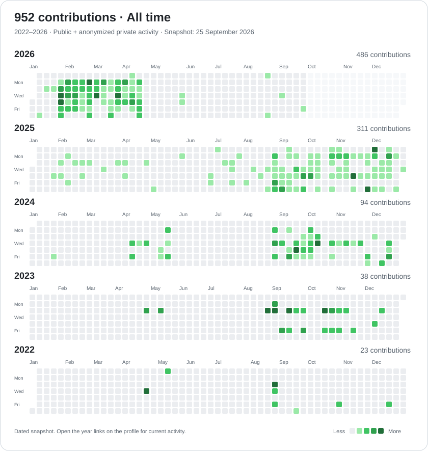

<!-- Profile source of truth: https://github.com/roldhaa/roldhaa -->

  

  
  
  

  <b>Building useful software, from the first idea to the final product.</b> 
  Open to software development jobs and internships in Greater Montréal.

  <a href="#-about-me">About</a> ·
  <a href="#-selected-projects">Projects</a> ·
  <a href="#-tech-stack">Tech stack</a> ·
  <a href="#-my-contributions-in-motion">Snake</a> ·
  <a href="#-experience">Experience</a> ·
  <a href="#-en-français">Français</a>

## 💫 About me

- 🎓 Studying **Computer Science and Software Engineering at UQAM**, after a DEC in Computer Science Technology at **Cégep Édouard-Montpetit**.
- 💻 I build web applications with **Angular, React, Next.js and ASP.NET Core**, and mobile products with **Flutter**.
- 🧠 Interested in **AI integrations, real-time applications and tools that help people learn**.
- 🤝 Experience across **mobile products, client websites and community platforms**.
- 📍 Based in **Montréal, Canada**. Comfortable working in **French and English**.

## 🚀 Selected projects

### 🔍 Screenshot Debugger

> **Comprends ton bug. Apprends à le résoudre.**

Turn an error screenshot into a guided investigation, an explained correction and a reusable Markdown error card.

| Hackathon meta | |
| --- | --- |
| Event | **Hacktoberfest Hack Day Montréal x AGEEI** — 9 October 2026 |
| MLH tracks | Best Use of Gemma 4 · Best Open-Source AI Project |
| Model | Gemma 4 open-weight `gemma-4-26b-a4b-it` (Gemini API = access channel only) |
| Live demo | [screenshot-debugger.vercel.app](https://screenshot-debugger.vercel.app) (Vercel Hobby, free) |
| Source | [roldhaa/screenshot-debugger](https://github.com/roldhaa/screenshot-debugger) · MIT |

    

**[Launch the demo ↗](https://screenshot-debugger.vercel.app) · [Read the source ↗](https://github.com/roldhaa/screenshot-debugger) · [Explore the model harness ↗](https://github.com/roldhaa/screenshot-debugger/blob/main/docs/HARNESS.md)**

<b>Peek under the hood: AI, validation and engineering decisions</b>

- **Visual AI analysis:** Gemma 4 `gemma-4-26b-a4b-it` reads an error screenshot and the supplied context through the Gemini API.
- **Guided reasoning:** Learn / Direct modes, numbered evidence, observations separated from hypotheses, and follow-up investigation.
- **Explained corrections:** before/after diff, change notes and manual verification steps. The application never executes the fix.
- **Reusable knowledge:** export a Markdown error card and retain it in the browser.
- **Reusable engineering:** an original model harness, Zod-validated reports, a CLI sharing the web diagnostic logic, and an Agent Skill.

**Stack:** Next.js · React · TypeScript · Tailwind CSS · Zod · `@google/genai` · Vitest · **Vercel**.

The API key stays on the server (`GEMINI_API_KEY`, never `NEXT_PUBLIC_`), uploaded images are validated, and suggestions remain under the user's control. Public source code under the **MIT license**. Built on **9 October 2026**.

 

| Project | What I built | Explore |
| :--- | :--- | :--- |
| 🗺️ **Nid de poule** | Road-hazard reporting prototype with photos, geolocation, **Flutter, Firebase and Mapbox**. | [Source & setup ↗](https://github.com/roldhaa/niddepoule) |
| 🃏 **Super Cartes Infinies** | Multiplayer card game with **Angular, ASP.NET Core, SignalR**, JWT authentication and asynchronous matchmaking. | [Project overview ↗](https://github.com/roldhaa/Super-Cartes-Infinies-demo) |
| 💬 **Post Hub** | Forum platform with **Angular, ASP.NET Core and SQL Server**, hierarchical roles, media management and Swagger documentation. | [Project overview ↗](https://github.com/roldhaa/Posthub-demo) |

Super Cartes Infinies and Post Hub are public project presentations. Their repositories do not currently include application source code or runnable demos.

## 💻 Tech stack

**Web**

      

**Mobile**

   

**Backend & data**

       

**Cloud, quality & tools**

        

<b>Architecture, APIs and development practices</b>

REST APIs · Entity Framework Core · Azure DevOps · Object-oriented programming · MVC · MVVM · Clean Architecture · Agile/Scrum

**AI integration:** Gemma 4 · Gemini API · `@google/genai` · schema validation with Zod.

## 🐍 My contributions in motion

  <picture>
    <source media="(prefers-color-scheme: dark)" srcset="https://raw.githubusercontent.com/roldhaa/roldhaa/output/github-snake-dark.svg" />
    <source media="(prefers-color-scheme: light)" srcset="https://raw.githubusercontent.com/roldhaa/roldhaa/output/github-snake.svg" />
    
  </picture>

  My GitHub contribution calendar, one square at a time. Refreshed daily. 
  

<b>Time capsule: my contribution history, 2022 to September 2026</b>

**952 contributions recorded across 2022–2026.** Public activity and anonymized private contributions.

| Year | Contributions |
| --- | ---: |
| [2026](https://github.com/roldhaa?tab=overview&from=2026-09-01&to=2026-09-25) | 486 |
| [2025](https://github.com/roldhaa?tab=overview&from=2025-12-01&to=2025-12-31) | 311 |
| [2024](https://github.com/roldhaa?tab=overview&from=2024-12-01&to=2024-12-31) | 94 |
| [2023](https://github.com/roldhaa?tab=overview&from=2023-12-01&to=2023-12-31) | 38 |
| [2022](https://github.com/roldhaa?tab=overview&from=2022-12-01&to=2022-12-31) | 23 |
| **Total** | **952** |

*Snapshot: 25 September 2026. This overview does not update automatically. Follow the year links for current counts. These are all years available on this GitHub profile.*

## 💼 Experience

| Where | What I worked on |
| :--- | :--- |
| **Spryto** · Software development 2024 to September 2026 | Flutter and Firebase mobile product development, including authentication, video streaming and Team of the Week features. |
| **Krunch Marketing** · Web development October 2025 to present | Responsive client websites and landing pages built from Figma designs, with design and marketing teams. |
| **Tail'ed** · Software development internship March to May 2026 | Software development for a community platform. |
| **TD Bank Group** · Bilingual customer support June 2026 to present | French and English support for EasyLine banking services and digital platforms. |

## 🏆 Beyond the code

- **OSEntreprendre Challenge 2025:** national finalist in the university category with **Spryto**.
- **ApplÉTS Mobile Challenge 2025:** recipient of an **ÉTS student scholarship**, with a mobile application delivered during a **24-hour hackathon**.
- **Hacktoberfest Hack Day Montréal x AGEEI (9 October 2026):** built **[Screenshot Debugger](https://github.com/roldhaa/screenshot-debugger)** for MLH tracks Best Use of Gemma 4 and Best Open-Source AI Project — live on [Vercel](https://screenshot-debugger.vercel.app).

## 🇨🇦 En français

<b>Mon profil, mes projets et ce que je recherche</b>

Développeur web et mobile bilingue, diplômé en techniques de l'informatique au Cégep Édouard-Montpetit et étudiant au baccalauréat à l'UQAM.

Je développe des applications avec **Angular, React, Next.js, ASP.NET Core et Flutter**, avec un intérêt pour les applications temps réel, les produits mobiles et les intégrations IA.

Mon projet à découvrir : **[Screenshot Debugger](https://github.com/roldhaa/screenshot-debugger)** (Hacktoberfest Hack Day Montréal x AGEEI, 9 oct. 2026 — Best Use of Gemma 4 · Best Open-Source AI Project). Une capture d'erreur devient une enquête, une correction expliquée et une fiche réutilisable. **[Essayer la démo Vercel ↗](https://screenshot-debugger.vercel.app)**

Je recherche un **emploi ou un stage en développement logiciel dans le Grand Montréal**.

**[Échangeons sur LinkedIn ↗](https://www.linkedin.com/in/haroldtch/)**

---

  <b>Build something useful. Learn something new. Keep going.</b> 
  Thanks for stopping by. Let's build something together.

